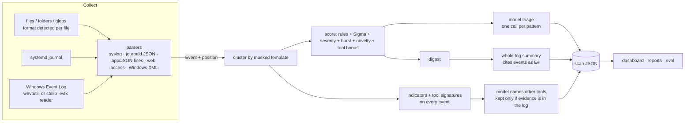

# LogIngestLLM: engineering notes

How it is built and why. The [README](../README.md) is the user-facing guide.

## Goals and constraints

- **Local only.** Logs never leave the machine: no cloud LLM, no telemetry, no downloads at analysis time. The
  dashboard binds to `127.0.0.1` and checks the `Host` header (DNS-rebinding guard).
- **Your own model.** A QLoRA fine-tune of `Qwen/Qwen3-4B-Instruct-2507` (Apache 2.0) that trains on one 8 GB GPU,
  improved by the owner's labels. Training from scratch was ruled out on compute grounds.
- **Evidence over eloquence.** A small model is fluent but fallible, so every claim the product shows is tied back
  to the log: model-named tools are dropped unless their evidence string occurs in the log, answers cite numbered
  log lines that open the original file at that line, and a known-answer evaluation gates changes.
- **Two audiences.** People learning to read logs (explanations, reference, "check it yourself" commands) and SOC
  analysts (ATT&CK, indicators, pivots, Sigma, timeline, reports).
- **Standard library only** for the analyzer. The trainer has its own virtualenv (torch, transformers, peft,
  bitsandbytes). Even `.evtx` and compressed Prefetch (LZXPRESS Huffman) decoding are implemented in-house rather than pulled in
  as dependencies.

## Pipeline

1. **Collect.** Every source becomes `Event(ts, host, source, severity, message, program, event_id, fields, loc)`.
   `loc` is where the event lives: file + line + byte offset, journal cursor, or Windows record ID. Text parsers get
   positions through `Line`, a `str` subclass that carries them, so the parsers themselves stay simple.
2. **Cluster.** Messages are masked (`<ip>`, `<n>`, `<path>`, `<hex>`, `<uuid>`, `<ts>`) and grouped by
   host + source + program + event ID + template, so 4,000 cron lines become one pattern.
3. **Score.** Rule score (~65 built-in rules plus any Sigma rules) + severity + burst + novelty against a per-host
   baseline of patterns seen in earlier scans. Patterns containing a catalog tool get a bonus, but only for what it
   adds beyond a rule that already describes the same behaviour (no double counting).
4. **Review.** The top patterns go to the model one at a time (`mode = "triage"`), which is the shape it was trained
   on. Whole-log summaries, tool naming, explanations and Q&A use `summary_model`: the same weights with the adapter
   switched off (`serve.py` serves `logagent` and `logagent-base`), because the triage adapter is specialised for JSON
   verdicts.
5. **Store.** `data/scans/<id>.json` holds findings, up to 300 lower-scored patterns (training negatives), tools,
   indicators, the summary and citation references.

## Modules

| module | role |
|---|---|
| `collectors/sources.py` | source specs → events; `files` type with per-file `detect_format()`; files over 100 MB are read from their newest 100 MB |
| `collectors/textlogs.py` | syslog (RFC 3164/5424/ISO), journald JSON, app logs (text or JSON lines, tracebacks folded), web access logs (combined format) |
| `collectors/windows.py` | live channels and exported `.xml`/`.evtx` via `wevtutil`; without it, `evtx.py`. Unrendered events get a readable message from the reference title + `Field Name: value` pairs, so rules written for Windows' rendered text match both |
| `collectors/prefetch.py` | `.pf` reader: MAM header → LZXPRESS Huffman ([MS-XCA] 2.2; ntdll on Windows, pure Python elsewhere, cross-checked against ntdll in CI) → SCCA v17/23/26/30/31 → one event per run time |
| `collectors/evtx.py` | stdlib `.evtx` reader: 64 KB chunks → BinXML token stream (names in the chunk string table, templates with typed substitutions) → event XML |
| `signals.py` | built-in rules (`event_ids`, `providers`, `pattern`, `exclude`, `min_count`, `max_severity`); Linux/app rules don't apply to Windows events (they would match words inside PowerShell script blocks) |
| `sigma.py` | Sigma support with a small YAML reader; unsupported constructs are skipped and counted, never half-applied |
| `analysis.py` | masking, clustering, scoring, per-host novelty baseline |
| `tools.py` | tool catalog (attacker / abused built-ins / scanners / remote access / tunnels / miners), score bonus, the verified model pass |
| `iocs.py` | indicators with exact counts and first-sighting positions; IPv4-mapped addresses folded; documentation ranges are `reserved`, not `private` |
| `knowledge.py` | offline reference: ATT&CK, Windows/Sysmon event IDs, logon types, NTSTATUS codes, Linux messages, programs, fields. Only notable-in-themselves events are *mapped*; routine ones show techniques as context |
| `explain.py` | "Explain this event": annotated tokens, anatomy, decoded fields, native commands per origin OS |
| `summary.py` | digest (never raw logs), origin-OS detection from source types and message evidence, rules-only fallback |
| `logview.py` | jump to the event: resolves references from the saved scan (the browser never names a file); files by byte offset, `.gz` by line, journal by cursor, Windows by record ID |
| `report.py` | Markdown / printable HTML incident report with citations resolved to `file:line` |
| `labelqueue.py` | unlabeled patterns across all scans, prioritised by what a label teaches the model |
| `evals.py` | known-answer scenarios (`evals/scenarios.json`): deterministic checks in the test suite, model checks on demand |
| `locations.py` | log locations: per-OS discovery, browse/pick, validation, editing `logagent.toml` in place (comments kept, `.bak` written) |
| `server.py` + `static/index.html` | dashboard (stdlib `http.server`, one HTML file, no build step) |
| `train/` | dataset builder: your labels (×3) + rule labels on your scans + synthetic Linux / Windows / web scenarios |
| `bundled.py` | the built-in AI engine: finds llama.cpp + model next to the app, joins split model files (SHA-256 checked), starts/stops the server, switches the adapter per request |
| `paths.py` | source checkout vs packaged app: bundled resources, the folder next to the executable, per-user data |
| `trainer/` | separate venv: `train.py` (QLoRA, fits 8 GB), `evaluate.py`, `promote.py` (gate), `serve.py`, `export.py` (GGUF for the app) |
| `packaging/` | `fetch_llama.py` (prebuilt llama.cpp per OS), `build.py` (PyInstaller app folder + engine), `launcher.py` (entry point) |

## The model

- **Base:** Qwen3-4B-Instruct-2507, 4-bit NF4 (bitsandbytes), LoRA rank 16 on all projection layers.
- **Task:** one log pattern in (host, source, program, event ID, severity, count, first/last, samples, fields, optional
  rule hint), one JSON verdict out (`importance`, `title`, `why`, `action`). `TRIAGE_PROMPT` and `triage_input()` are
  shared by training and inference; changing either requires a retrain.
- **Data:** your labels from the dashboard (weighted ×3, the only signal that can make it better than the rules),
  rule-derived labels on your real scans, and synthetic Linux, Windows and web scenarios that go through the real
  parsers, clustering, rules and tool detection. Rule hints are hidden from half the examples so the model learns to
  recognise events on its own. Targets cite the concrete values the model can see (times, counts, IPs, users).
- **Gate:** `trainer/promote.py` scores the new adapter and the current one on the same held-out sample (your labels
  decide once there are 10 of them) and only then moves `models/ACTIVE`. `python -m logagent eval --model` then
  checks the whole co-pilot on the known-answer scenarios.
- **Shipped inside the app:** `trainer/export.py` writes the base model as quantized GGUF (split under GitHub's 2 GB
  release limit) and the adapter as a GGUF LoRA. `bundled.py` starts llama.cpp's server from `engine/` on
  `127.0.0.1`, loads the adapter without applying it, and switches it per request (`POST /lora-adapters`): on for
  triage, off for summaries and questions, which mirrors `serve.py`. GPU build first (Vulkan/Metal), CPU fallback.
  `packaging/build.py` + `.github/workflows/release.yml` build Windows, macOS (arm64, x64) and Linux downloads.

## Evaluation

`evals/scenarios.json` describes investigations with known answers: a Windows intrusion, a Linux break-in, a scanned
web server, a failing device, a healthy laptop (false-alarm guard), plus any private cases you keep
in `evals/local/*.json` (git-ignored, for logs you can't publish).

- **Deterministic** (every test run and CI): expected rules, top finding, tools with positions, indicators,
  ATT&CK techniques, "tool patterns reach the findings", and false-alarm guards (no risky tools, no ATT&CK mapping,
  no finding above a score on the benign log).
- **Model** (`python -m logagent eval --model`): minimum triage importance for key patterns, nothing above medium on
  the benign log, summary must mention the key facts, must not contain unsafe advice (stopping `sshd` on a remote
  machine, disabling the firewall, `rm -rf /`), every citation must resolve, and a cited answer to "what happened?".

Reports land in `models/copilot-eval-*.json` and each run is compared with the previous one.

## Security notes

- Local only; binds `127.0.0.1`; `Host` header check; JSON-only POSTs (no CSRF via simple forms). If the dashboard is
  ever bound beyond localhost, file browsing, source editing and file-picking are refused.
- The browser never sends file paths to read: the log viewer resolves references from scan files the server wrote.
- Source specs are validated (systemd unit and channel names against allowlists; no control characters in paths).
- Log text is untrusted input to the model: every prompt says so, model output is parsed as data, model-named tools
  are verified against the log, and citations are resolved server-side.

## Limitations

- A 4B model on an 8 GB GPU: about 3 s per pattern, about 50 s per summary; long questions are capped at about
  7k tokens.
- Scans keep grouped patterns plus samples, not every raw event. The originals stay where they are and the viewer
  reads them on demand, so a moved or rotated file can't be opened from an old scan.
- Exported `.evtx` files read without Windows have no message templates; messages are rebuilt from the reference and
  the event's fields.
- Sigma: no aggregations, correlations or base64 modifiers; such rules are skipped and counted.
